# Features

Screen notes for [MaksIT Cluster Console](../README.md). The README lists each area in one line. This page is the button names, columns, and screenshots.

## Cluster overview

Click a catalog row to open that context. A green dot is a live session in this app. The radio is labeled **kubectl context** and only writes kubectl `current-context` for the command line. This app does not follow that field. Until a row is open, the window stays on the catalog and asks you to select a cluster. Open clusters stay connected until you disconnect them. **Connections…** and **Reload kubeconfig** sit under the catalog. The status line counts contexts in the kubeconfig and how many are connected here.

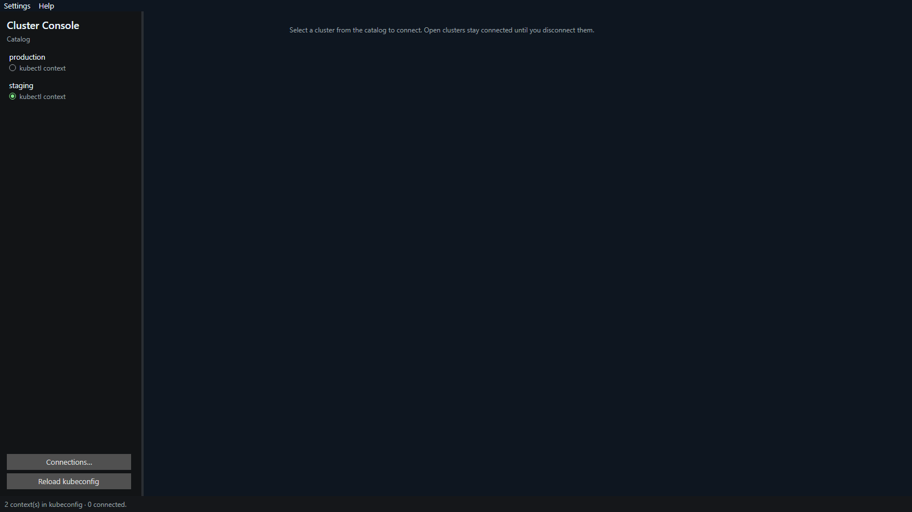

Overview names the Kubernetes version and how many nodes are in the cluster. **Cluster** and **Nodes** switch the charts. CPU, memory, and pods show usage, requests, limits, allocatable capacity, and capacity from metrics-server. **Resource limits** lists containers you can patch, and **Apply selected** writes the chosen CPU and memory against node capacity. Under the charts, Errors and Warnings list node, pod, and event problems, a LoadBalancer Service that is Pending or Unreachable, and a PersistentVolumeClaim that is Pending. When nothing is wrong, that pane says no issues were found. When Settings → AI is on, Chat sits on the right with the model name, **Analyze issues**, and **Clear**.

<!-- microsoft-store 1 -->
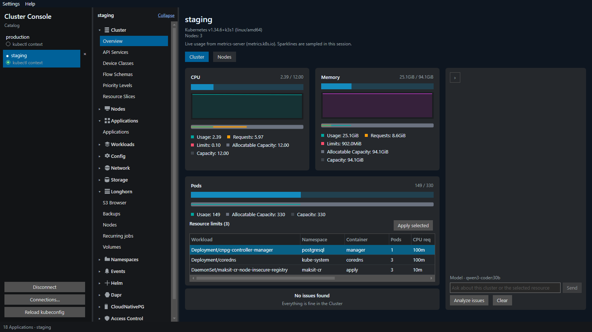

## Applications

One row per `app.kubernetes.io/instance` (or `name`) and namespace. Columns are Instance, Namespace, Managed by, Version, Ready, CPU, Memory, Status, and Age. CPU is percent of cluster allocatable. Memory is summed from owned pods when metrics-server is available. The details pane is Overview, YAML, Events, Pods, Logs, and Terminal.

<!-- microsoft-store 2 -->
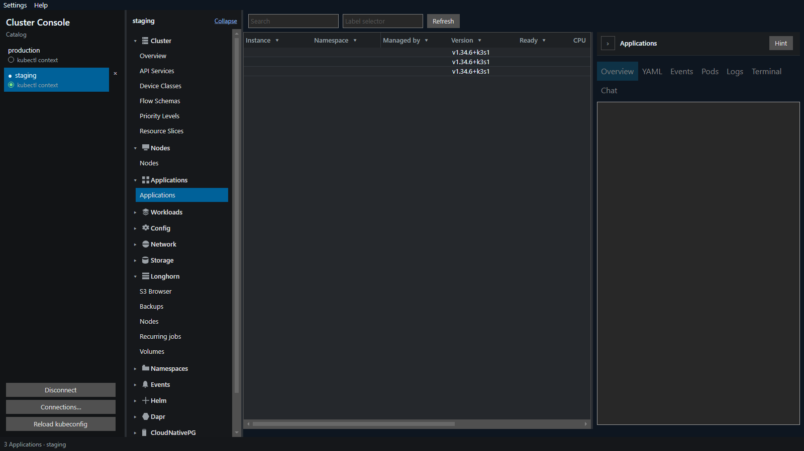

## Pods

Name, Namespace, Age, Ready, Restarts, Status, and Node, plus CPU and Memory when metrics-server is available. Filters and sort persist per cluster. The open table follows the API watch. Details: Overview, YAML, Events, Logs, Terminal, and Chat. **Container** picks which container logs, the shell, Attach, and Debug use. The footer is **Delete**, **Force delete**, **Attach**, the debug image (default `busybox:1.36`), **Debug**, a local port, a remote port, and **Port-forward**. **Attach** follows that container's output. **Debug** adds an ephemeral container beside it. Kubernetes leaves that container on the running pod. It is gone when the pod is recreated. **Force delete** uses grace period 0 and strips finalizers.

<!-- microsoft-store 3 -->
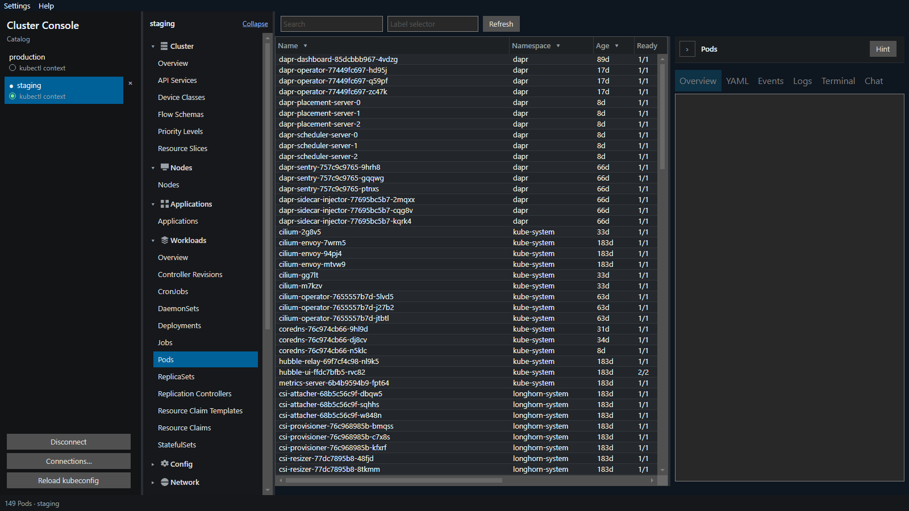

**Logs** names the container image and shows that container's output. **Follow** tails new lines instead of a one-time snapshot.

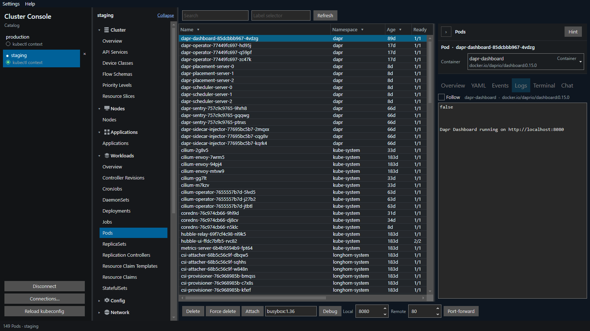

## Chat

Settings → AI opens **Local Ollama**. **Enable chat** turns Chat on, on a resource and on the cluster overview. The endpoint and model are any local [Ollama](https://ollama.com) model you already pulled. The default model is `qwen3:8b`. Reading the cluster is enough with that model. Repairs work better with `qwen3:14b` or larger (`qwen3:32b`, `qwen3-coder:30b`). **Timeout** is how long one reply may run, in seconds. The default is 240.

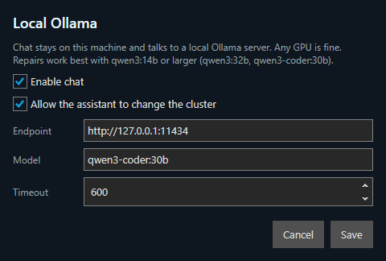

On a selected resource, Chat has **Ask about selection** and **Clear**. On the overview, **Analyze issues** explains the current warnings and errors. Read-only tools are cluster issues, object YAML, logs, and events. **Allow the assistant to change the cluster** adds restart, pod delete (not force-delete), scale, and YAML apply. Each of those waits for **Approve** or **Reject** in the chat. Reject leaves the cluster unchanged. No cloud AI API. Chat is read-only until that switch is on.

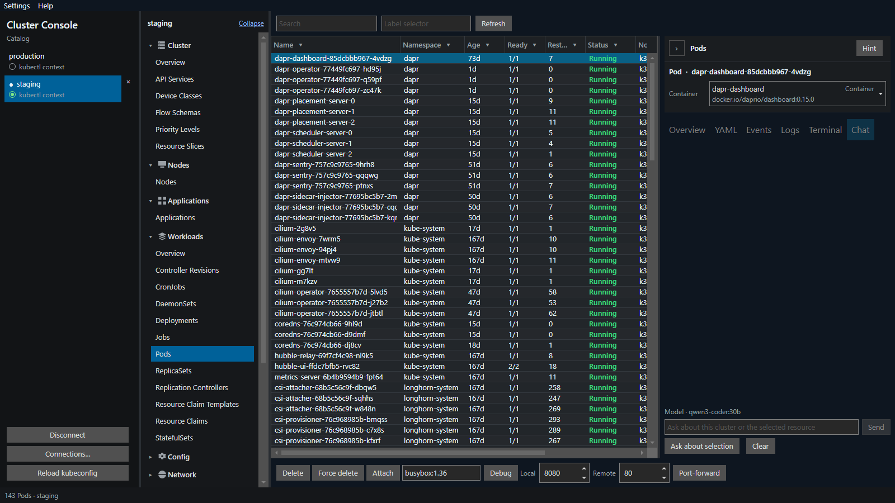

## Volume files

Browse, edit, download, and upload files on a PersistentVolume or claim. Double-click a PV/PVC row, or use **Browse files** on the selected row.

## Dapr

The navigator lists Components, Configurations, Subscriptions, Resiliency, HTTP Endpoints, Sidecars, and the control plane.

The control plane is the system processes in the `dapr` namespace: injector, operator, placement, and sentry. These are not application sidecars. Status and restarts show whether that system is up.

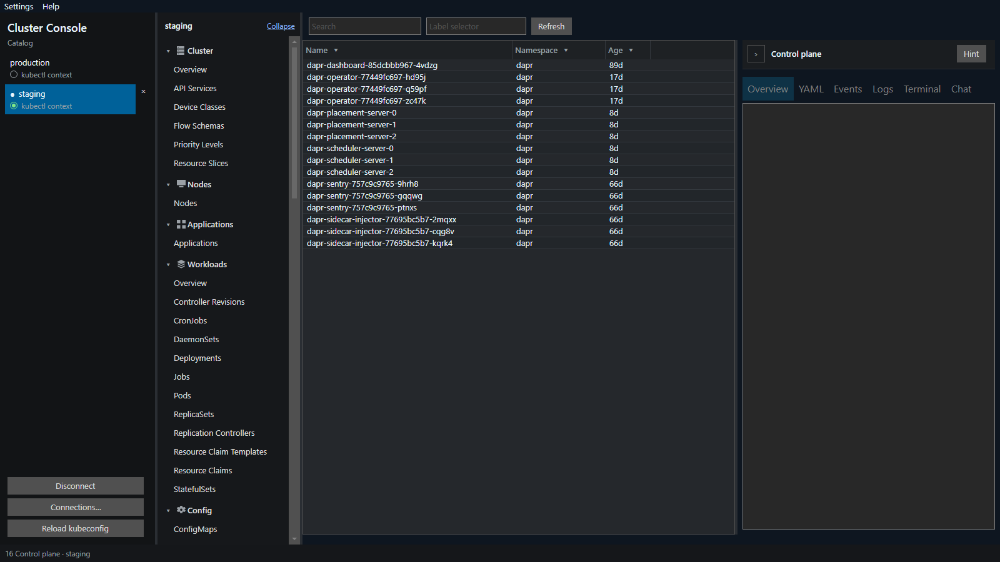

A Configuration is sidecar settings for apps that reference it: tracing, metrics, and which features are on. It is not a ConfigMap, and it is not a Component.

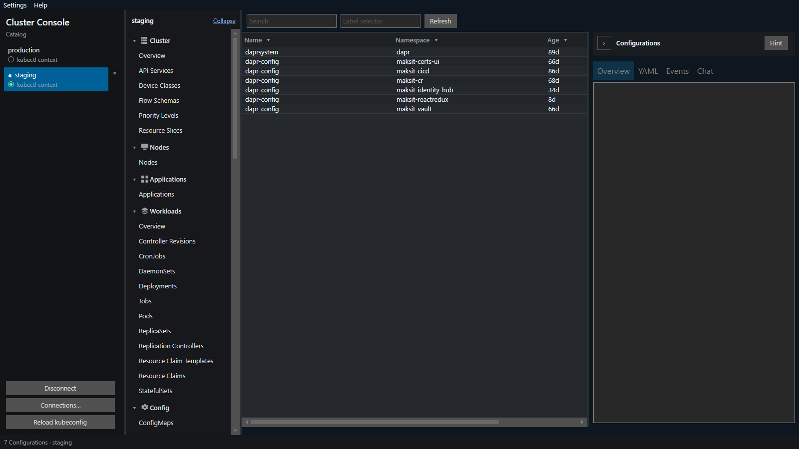

A Subscription says an app wants messages from a topic. Topic is the name. The sidecar receives them and posts them to the app.

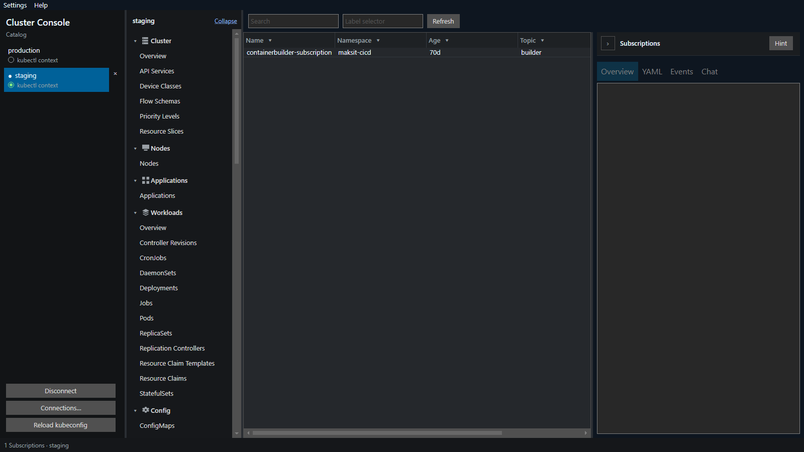

A sidecar is the `daprd` container in an application pod. This list is those pods: Name, Namespace, and Age. Logs and a terminal are for that pod. Details are Overview, YAML, Events, Logs, Terminal, and Chat.

<!-- microsoft-store 8 -->
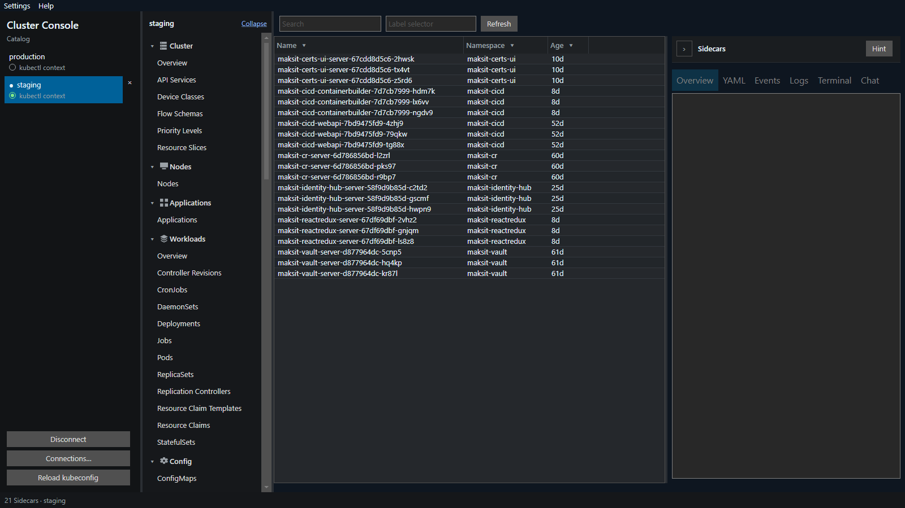

## Port forwarding

**Network → Port Forwarding** lists each tunnel as `localhost:{port}`, the namespace, the pod, and the local and remote ports. Tunnels persist, restore on reconnect, and retarget a running pod. Double-click an active forward to open `http://127.0.0.1:{port}/`. **Rebind** changes the local port. The same local port, remote port, and **Port-forward** sit on a pod or Deployment footer. Details are Overview, YAML, and Chat.

<!-- microsoft-store 6 -->
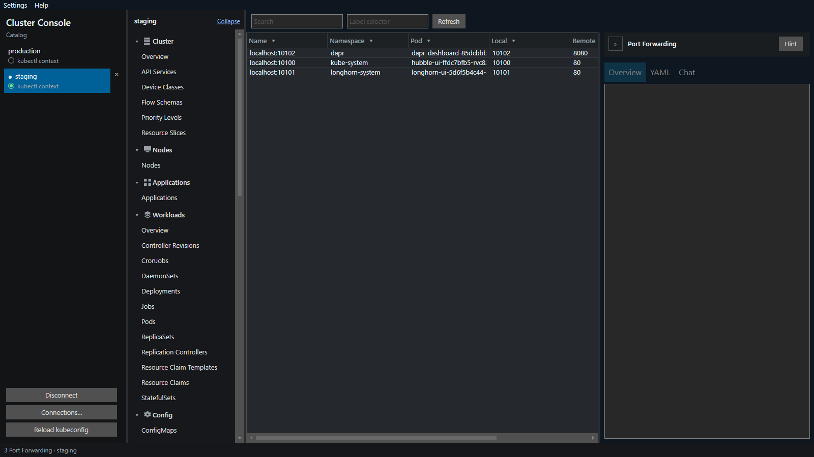

## Connections

**Connections…** opens **Kubeconfig connections** for the file on disk. Each row is a context and its API server. The radio is **kubectl context**. A green dot is a live session in this app. The details pane shows the namespace, cluster name, server, whether TLS verify is skipped, whether CA data is present, the user, and how that user authenticates. **Add…** writes a context you fill in: bearer token, client certificate, pasted k3s certificate data, username and password, or an exec plugin when you already know the API server. **Cloud…** is a separate window for Google Kubernetes Engine, Azure Kubernetes Service, Amazon EKS, Oracle Kubernetes, DigitalOcean Kubernetes, and IBM Cloud Kubernetes. Sign in with that provider's CLI first. The window runs `gcloud container clusters get-credentials`, `az aks get-credentials`, `aws eks update-kubeconfig`, or the Oracle, DigitalOcean, or IBM command, and that CLI writes the API server, certificate, and login. The program must be on PATH. On Linux, **Download CLI** in that window installs gcloud, az, aws, oci, doctl, ibmcloud, or kubelogin into the app and puts them on PATH. The Flatpak sandbox starts that copy, including an exec plugin the kubeconfig names, so a token refresh runs inside the sandbox. A login already saved in the home directory is reused. Published checksums are checked. The AWS CLI zip is checked with the AWS CLI public key. A CLI installed on the host is not visible to the sandbox. **Connect** opens the selected context here. **Delete** removes it. **Cleanup unused cluster/user on delete** also drops a cluster or user entry that nothing else references. This app ignores kubectl `current-context` and uses the row you click. Several contexts stay connected until you disconnect them, while kubectl still has one current context. **Reload kubeconfig** rereads the file.

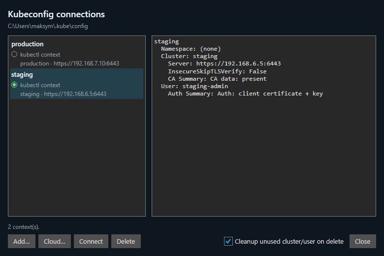

## Navigator

Cluster, Nodes, Applications, Workloads, Config, Network, Storage, Namespaces, Events, Helm, Dapr, Access Control, Custom Resources. Longhorn and CloudNativePG appear when those APIs are installed. Built-in kinds include admission policies, CSR, CSI objects, API services, flow control, and dynamic resource allocation, plus any CRD installed in the cluster.

## Longhorn

Longhorn is its own navigator group when that API is installed: **Volumes**, **Nodes**, **Recurring jobs**, **Backups**, and **S3 Browser**. These are Longhorn objects, not the Kubernetes node list and not a generic PersistentVolume. The screens view and operate Longhorn. They do not install it.

**Volumes** matches the Longhorn UI. **State** is attached or detached. Attached is green. Degraded or faulted is shown with the state when a replica is unhealthy. **Name** is the technical Longhorn name, usually `pvc-` and an id. **Volume** is the PersistentVolumeClaim name, the name you gave the disk. **Node** is the Longhorn node the volume is attached to, and the tip lists pods using it. **Size** is the requested size. **Actual Size** is the space the replicas use. **Created** is when Longhorn created the volume. **Data Engine** is v1 or v2. **PV/PVC** is Bound, Available, or Released, and the tip names the PV and PVC. **Namespace** is the claim's namespace, not `longhorn-system`. **Schedule** is the recurring jobs on that volume. **Last Backup At** is the time of the latest backup. **Attach** and **Detach** are in the footer. Attach picks a Ready node. Detach can force a leftover ticket off. **Schedule backup…** creates a periodic backup job and labels the selected volumes. The schedule is five cron fields, and the cron line stays visible. A degraded volume that is still attached, or a failed replica of it, beside a new detached volume for the same claim or one restored from its backup, is called out on the overview. Detach the leftover, then attach the new one. Do not delete the new volume.

<!-- microsoft-store 9 -->
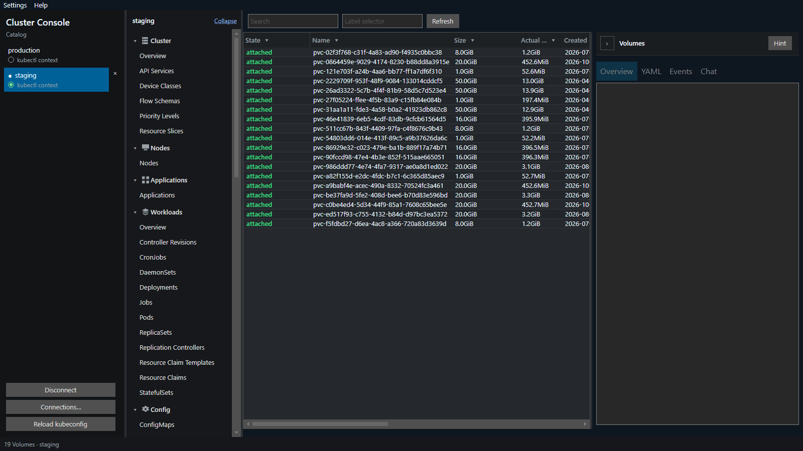

**Nodes** is Longhorn's record of one machine and the disks it may store replicas on. It is not the Kubernetes node, though the name matches. Columns are Name, Namespace, Scheduling, Disks, and Age. **Scheduling** is whether Longhorn may place new replicas there. **Disks** is how many disks Longhorn sees, how much space is free, and how many are not ready.

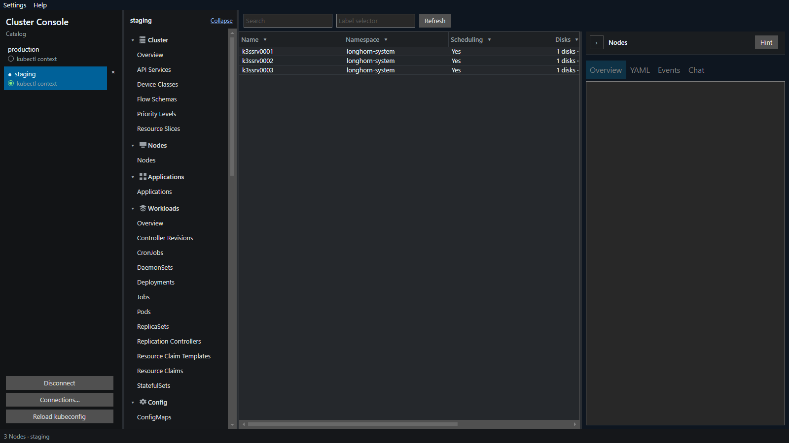

**Recurring jobs** is a Longhorn schedule. Columns are State, Name, Task, Schedule, Last Successful Run, Retain, and Groups. **State** is Running while a run is in progress, Failed when the latest run failed, and Idle when nothing is running. **Schedule** is when it runs. **Retain** is how many copies the job keeps. Snapshot Cleanup and Filesystem Trim do not use Retain. **Groups** are the Longhorn groups the job belongs to. The default group runs on volumes that have no other recurring job. **New job…** creates one. **Edit…** can change the name, which points the volumes at the new job and then removes the old one. **Run now** starts the selected job immediately, and does not start another while a run of that job is still in progress.

The task is what the job does:

- **Backup** copies a volume to the backup target, for a restore after the disk or the cluster is gone.
- **Snapshot** takes a local point in time, for a rollback while the volume is still there.
- **Snapshot Delete** removes local snapshots beyond Retain.
- **Snapshot Cleanup** purges snapshots Longhorn has already marked removable.
- **Filesystem Trim** releases unused filesystem blocks so Longhorn can reclaim the space.
- **System Backup** copies the Longhorn configuration so the installation can be rebuilt. Volume data still comes from volume backups. The job window shows **Volume backup policy**: If not present, Always, or Disabled.

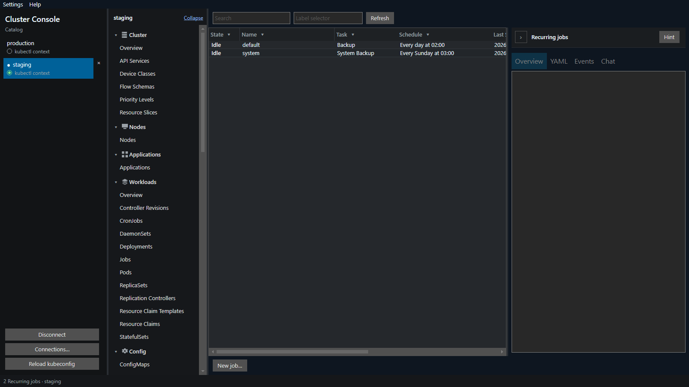

**Backups** is one row per volume in the backup target, the same list as the Longhorn UI. Longhorn does not keep a separate Backup object for each copy. Columns are State, Volume, Last Backup, Last Backup At, Created, Size, and Target. **Volume** is the Longhorn volume name, the same string as Volumes → Name. **Last Backup** is the newest backup name. **Last Backup At** is when it was taken. **Created** is when this volume first appeared in the target. **Size** is the size of the volume that was backed up. **Target** is which backup target holds the copy. **State** is Ready, Terminating, or Error. **Delete** removes that volume's backups from the target.

**S3 Browser** opens the default backup target and any other S3 targets. The target menu names the target, its URL, and how many buckets those credentials can see. **Reload**, **Add target…**, **Edit…**, and **Remove** sit on that bar. The backup bucket opens first. **New** creates a bucket. **Delete** removes a bucket and everything in it. A bucket used by a Longhorn backup target cannot be deleted. Adding a target writes the Longhorn backup target and its credential secret. Inside a bucket, **Open path** and **Filter** sit above the object list (Name, Kind, Size, Modified). The footer is **Refresh**, **Up**, **Open**, **New folder**, **Upload**, **Upload folder**, **Download**, **Delete**, **Rename**, and **Copy**. A small text object opens in its own window.

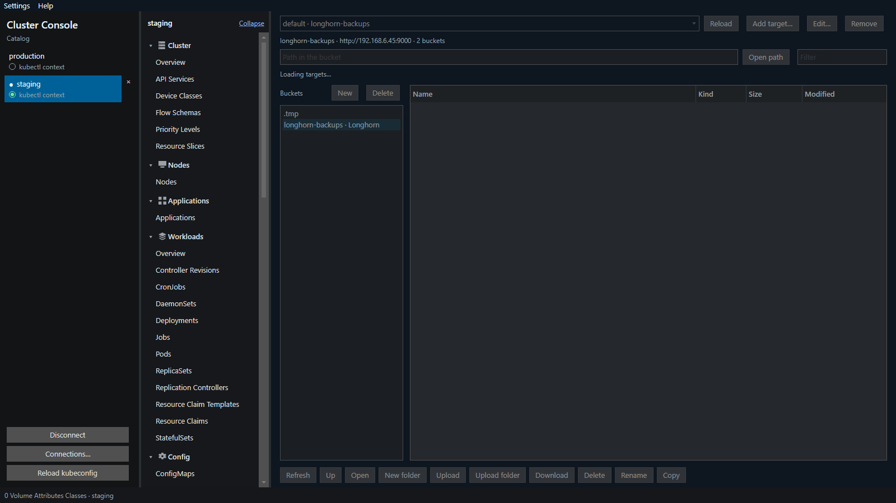

## Tables

**Search** filters rows already loaded. **Label selector** is sent with the list (`app=api`). The open table watches the API. Column filters and sort stay on this machine, per cluster. Copy includes the column header. **Hint** explains the kind on screen. Extended selection (Shift or Ctrl) plus a footer action that can run on its own applies to every selected row: Restart, Scale, Delete, Force delete, Force delete namespace, Cordon, Uncordon, Drain, Trigger, and Stop.

## YAML

View, server-side apply, create, and delete. **New** starts an empty document for a kind you can create. Apply falls back to create or replace when the API server rejects an apply patch. JSON and YAML highlighting follows the document. ConfigMap and Secret values use the key name (`.json`, `.yaml`, `.yml`) or stay plain.

<!-- microsoft-store 5 -->
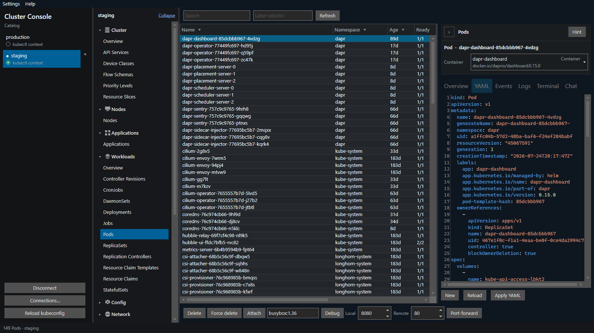

## Workloads

The Workloads overview is a tile for Pods, Deployments, StatefulSets, DaemonSets, ReplicaSets, and Jobs. CronJobs, ReplicationControllers, and the other workload kinds are their own pages in the navigator.

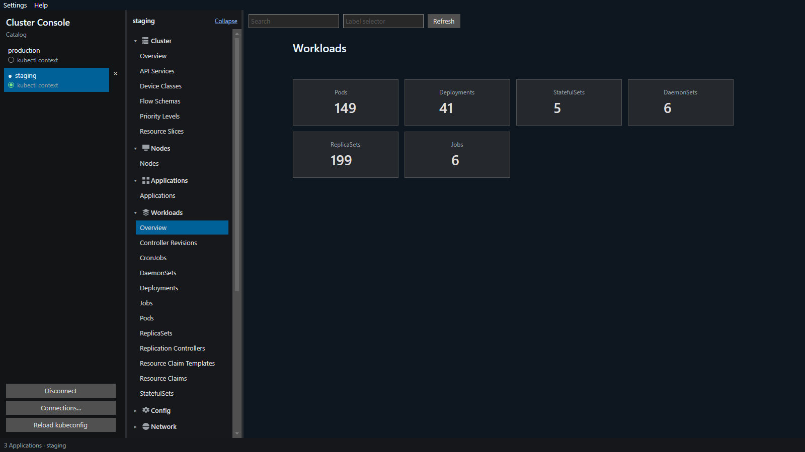

A tile opens that table. On a Deployment the footer is **Delete**, **Force delete**, a replica count, **Scale**, **Restart**, **Pause**, **Resume**, **History**, **Undo**, a local port, a remote port, and **Port-forward**. **Pod** and **Container** choose which pod Logs and Terminal follow. The Pods tab lists the pods of that workload. **Scale** also applies to a StatefulSet, ReplicaSet, or ReplicationController. **Restart** also applies to a StatefulSet or DaemonSet. **Trigger** starts a Job from a CronJob. **Force delete namespace** removes the selected namespace, except `default`, `kube-system`, `kube-public`, and `kube-node-lease`.

<!-- microsoft-store 4 -->
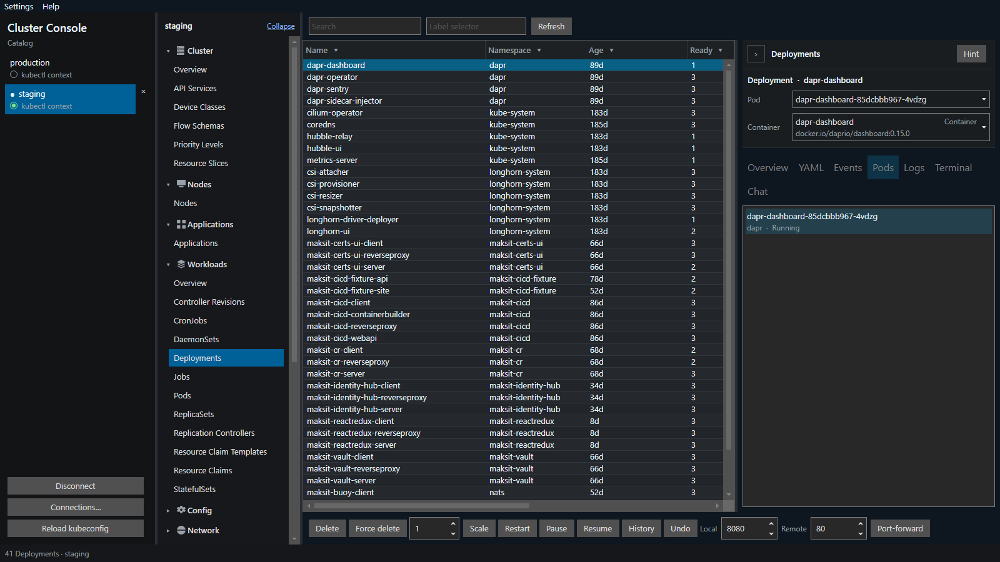

## Nodes

The table is Name, Status, Roles, and Version. Status is Ready in green. The footer is **Delete**, **Force delete**, **Cordon**, **Uncordon**, and **Drain**. Details are Overview, YAML, Images, Events, and Chat. **Cordon** refuses new pods. **Uncordon** accepts them again. **Cordon** and **Drain** stay hidden unless another Ready node can still take pods, so a single-node cluster has neither. **Uncordon** still restores a node that is already cordoned. **Drain** asks first. The dialog is a table: **Node**, **Outcome** (teal **Will move**, amber **Will remain**), **Namespace**, **Pod**, and **Reason**. Will remain covers a DaemonSet, a mirror pod, a completed pod, a pod with no controller, and any pod a PodDisruptionBudget would refuse. Long text wraps and the row grows. When AI is on, the dialog also includes a short note on whether it is safe to continue and which pods stay. The note does not drain the node. **Cancel** or Escape leaves the node as it is. **Drain** cordons the node and evicts only Will move. A refused eviction is not deleted.

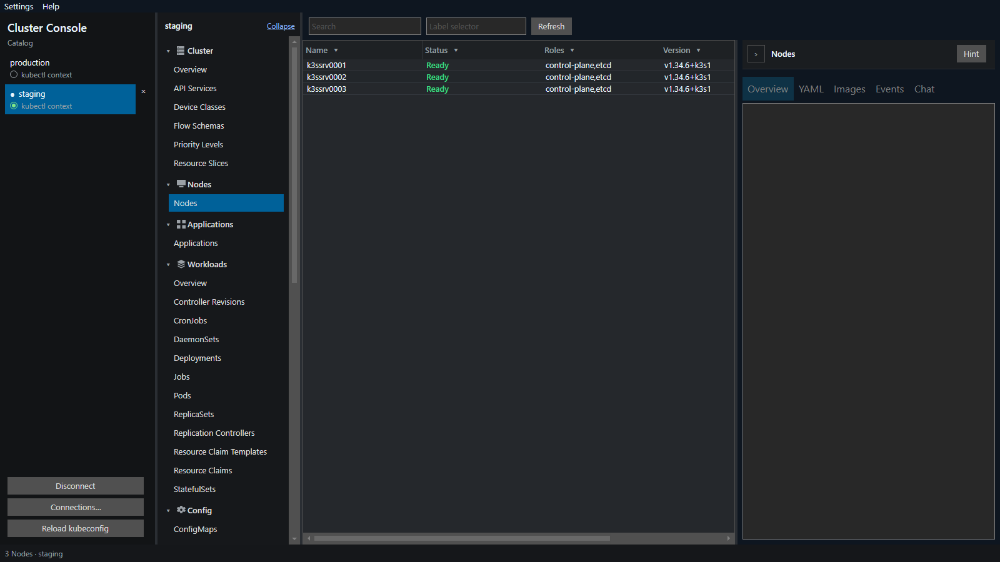

The Images tab marks cached images Used or Unused from the pods on that node. Columns are State, Image, Size, Pods, and other namespaces. The header counts used and unused images and their size. kubelet lists at most 50 images, largest first.

<!-- microsoft-store 10 -->
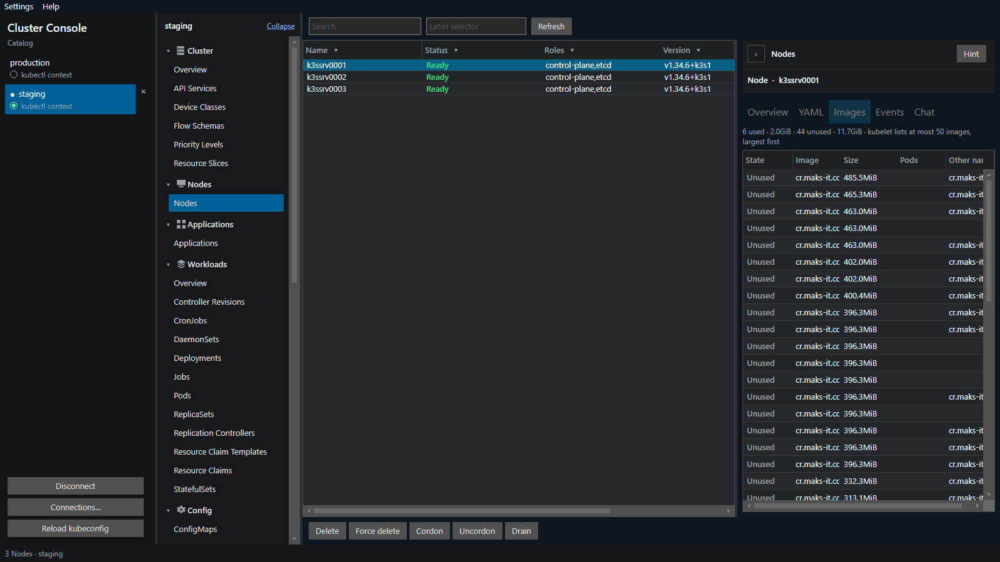

## Config

ConfigMaps and Secrets have a **Data** tab: keys, a decoded preview, a binary flag, **Add key**, and **Apply data**. Secret values are saved back as `stringData`. The same tables cover resource quotas, limit ranges, HorizontalPodAutoscalers, PodDisruptionBudgets, leases, runtime classes, webhooks, and admission policies.

## Network

A Service table is Name, Namespace, Age, and Type (`ClusterIP`, `LoadBalancer`, and the other Service types). **Status** is Active when a load-balancer address is assigned, Pending when none is set, and Unreachable when a requested or BGP address is not the one the cluster reports. Details are Overview, YAML, Events, Pods, and Chat. The navigator also lists Endpoints, EndpointSlices, Ingresses, NetworkPolicies, and IP addresses.

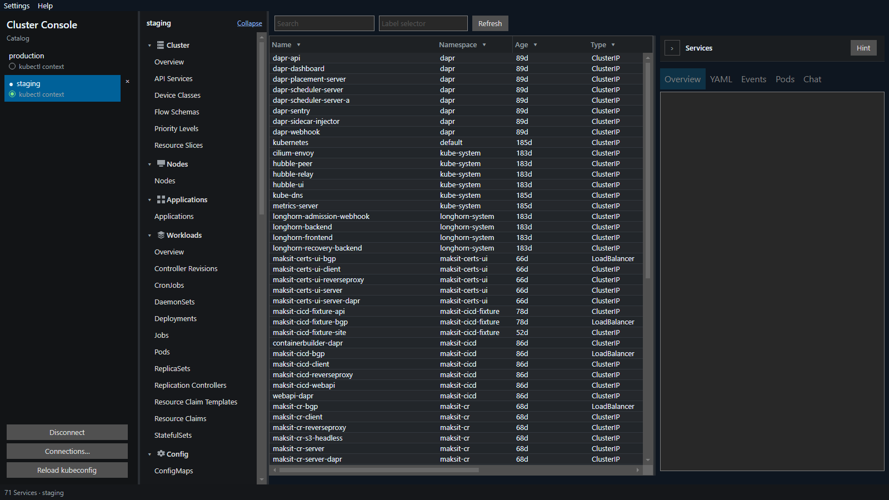

## Storage

A claim table is Name, Namespace, Age, and Status. Resize a PersistentVolumeClaim. **Reclaim** changes Delete or Retain on a storage class and its volumes. Changing the class itself is delete-and-recreate; the dialog explains the gap for new claims. CSI drivers, nodes, storage capacities, and volume attachments are in the navigator when the API has them. Double-click a PersistentVolume or claim, or use **Browse files**, to open files on that volume.

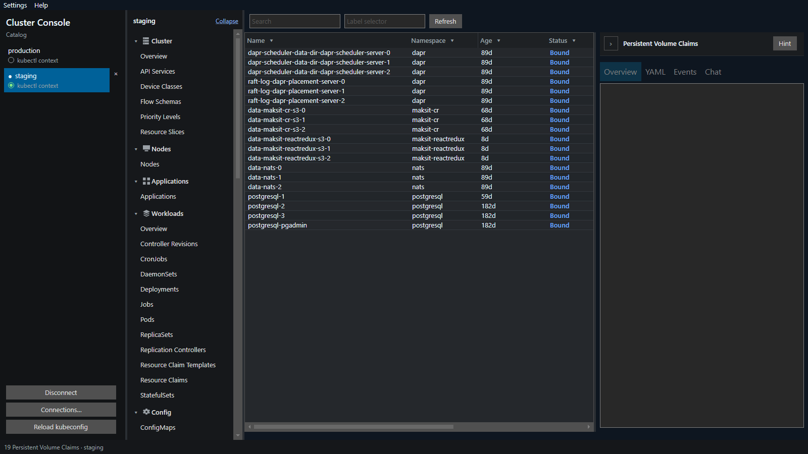

## Access

Approve or deny a certificate signing request. Signer is who should sign it. The decision is stored on the request. **Token** creates a ServiceAccount token and shows it once.

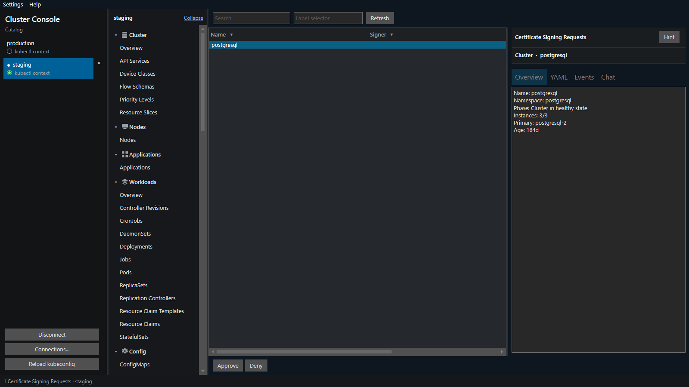

Roles, RoleBindings, ClusterRoles, ClusterRoleBindings, and ClusterTrustBundles are editable YAML like any other kind. A Role lists permissions in one namespace and grants nothing until a RoleBinding attaches it.

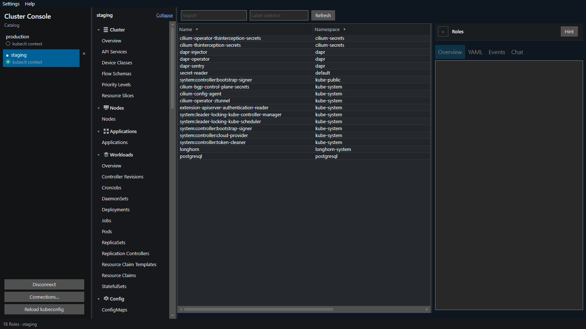

## Custom resources

Extra columns from the CRD `additionalPrinterColumns`.

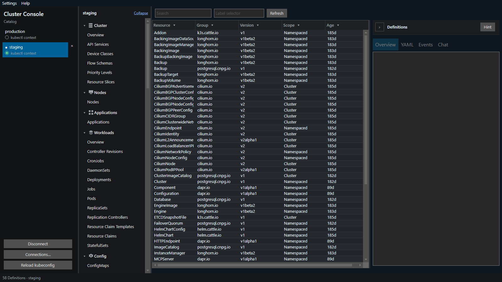

## Helm

Charts lists each chart version installed in the cluster, taken from Helm release secrets. Columns are Chart, Version, App, and Status. A release table is Name, Namespace, Revision, Status, and Chart. History lists every stored revision. **Compare** picks two revisions and shows the values diff under that pair, along with the user-supplied values and the rendered manifest. Chart install and upgrade stay on the Helm CLI.

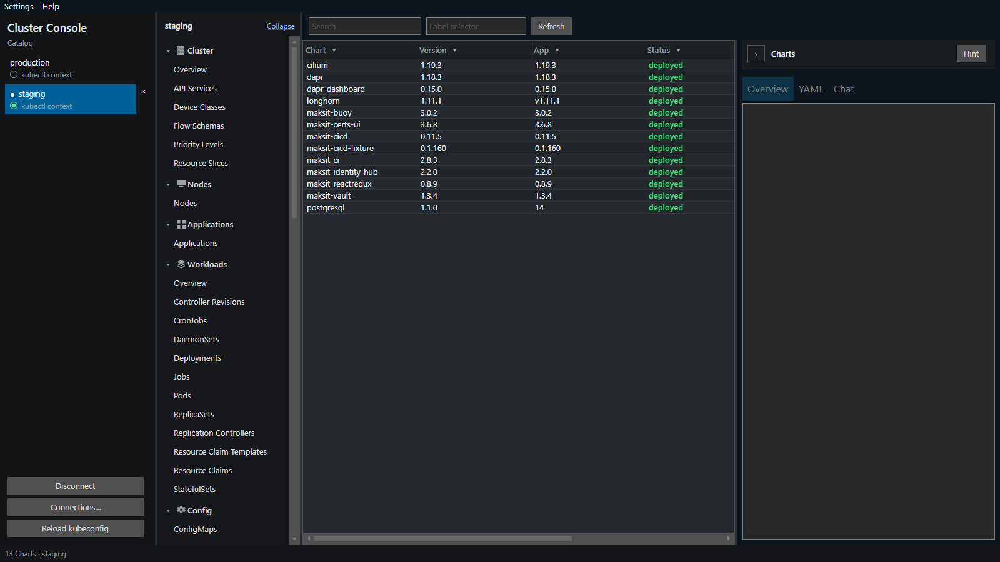

<!-- microsoft-store 7 -->
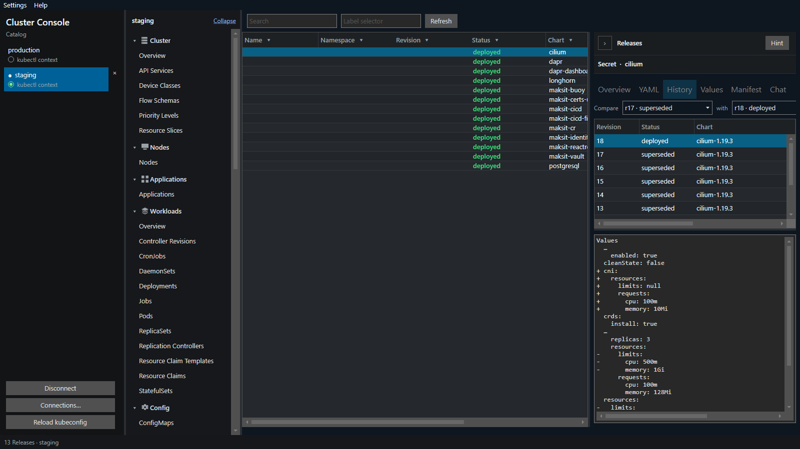

## Metrics

CPU and memory when the metrics API is available. Charts use the same metrics-server data as `kubectl top`.

## Help

**Hint** on a table explains that kind. Help → Logs shows the app log and crash reports. An unhandled error opens a window you can copy instead of closing the app. Help → About shows the product, license, and contact. After an upgrade, What's New lists additions since the version you last opened.
